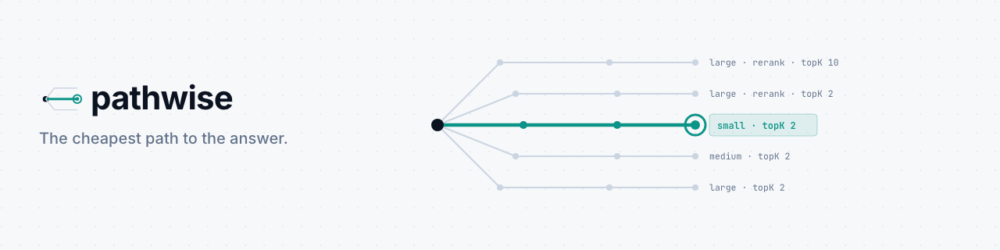

<picture>
  <source media="(prefers-color-scheme: dark)" srcset="assets/banner/readme-banner-dark.png">
  
</picture>

[](https://github.com/arsalan-arshad/pathwise/actions/workflows/ci.yml) [](LICENSE)

**A query planner for RAG and agent pipelines.** Declare the quality you need; Pathwise picks the cheapest way to deliver it, per request.

Databases have had query optimizers for 50 years. AI pipelines don't: teams hard-code one model, one `topK`, one reranker setting for every request, and pay frontier-model prices for "what are your opening hours?".

## How it works

1. **Mark your knobs.** Model, retrieval depth, reranker, agent step budget: anything that trades cost for quality.
2. **Calibrate.** Pathwise runs plans on a sample of your real queries and scores them: cheapest plans first, stopping at the first plan that wins each query, and pruning plans a cheaper one never loses to. About 9% of the cost of running every plan (`calibration: { strategy: "exhaustive" }` restores that).
3. **Plan per request.** For each new query it finds similar past queries, predicts each plan's quality, cost and latency, and runs the cheapest plan that meets your SLA.
4. **Keep learning.** A fraction of production runs are scored and fed back, so it adapts as models and prices change.

```ts
import { createPlanner } from "pathwise";

const planner = createPlanner({
  space: { model: ["small", "medium", "large"], topK: [2, 5, 10], rerank: [false, true] },
  pipeline: async (query, plan) => {
    const answer = await myRag(query, plan); // your existing code, now parameterised
    return { output: answer, costUsd: answer.cost };
  },
  scorer: (query, answer) => judge(query, answer), // 0..1: eval set or LLM judge
  sla: { minQuality: 0.9, maxLatencyMs: 3000 },
});

await planner.calibrate(sampleQueries);
const { output, plan } = await planner.run(userQuery);
```

## SLA guarantee

By default Pathwise picks the cheapest plan whose *average* predicted quality meets `minQuality`.
Set `confidence` to turn that into a guarantee you can check:

```ts
const planner = createPlanner({
  // ...
  sla: { minQuality: 0.95, confidence: 0.9 }, // 90% confidence that delivered quality >= 95%
  scorerErrorRate: 0.1, // your LLM judge disagrees with human labels 10% of the time
});

const report = await planner.calibrate(sampleQueries);
report.slaCertified; // false = not enough evidence yet; Pathwise plays safe (or set onUncertified: "best-effort")
```

How it works: after calibration, Pathwise replays every calibration query as if it had never seen it,
and raises its internal quality bar until the replayed results clear `minQuality` at the requested
confidence (Wilson lower bound). If no bar does, it runs the best plan for every request until you
add calibration samples. With a noisy judge, set `scorerErrorRate`: calibration then majority-votes
each verdict, confirms passes with extra votes, and corrects scores for the judge's error rate.

**Your own fallback.** If calibration cannot certify the SLA, the default "safe" mode runs one plan inferred from the
calibration data. Declare the plan you trust today instead, and uncertified runs use exactly that plan:

```ts
sla: { minQuality: 0.95, confidence: 0.9, fallbackPlan: { model: "large", topK: 10, thinking: "high" } }
// report.policy === "safe-plan" and report.fixedPlan === that plan's key while slaCertified is false
```

It must be a plan in your knob space and needs `confidence` and `onUncertified: "safe"` (the default); anything else throws. While it runs, `maxCostUsd` and `maxLatencyMs` are not enforced, and its estimate is weak if calibration
never measured it (adaptive calibration may skip pricey plans), so pick a plan you expect calibration to run.
Synthetic check (`npm run bench:fallback`, 5 workloads, 30 samples, 99% bar): every uncertified request ran the fallback,
so accuracy and cost equal running that plan directly (e.g. 79.0% at $1.20 per 300 queries, both ways). No extra runs.

Simulated benchmark (`npm run bench:sla`, **synthetic**, 20 random workloads per row, 1,000 production queries,
"messy" = question text predicts difficulty poorly, "noisy" = judge wrong 10% of the time):

| Scenario (95% SLA) | Calibration samples | SLA misses: average-based | SLA misses: guaranteed | Cost: average-based | Cost: guaranteed |
|---|---|---|---|---|---|
| messy | 90 | 17/20 | **0/20** | $7.12 | $30.28 |
| messy | 300 | 17/20 | **0/20** | $6.84 | $14.06 |
| messy + noisy judge | 300 | 4/20 | **0/20** | $21.41 | $23.08 |
| clean | 300 | 0/20 | 0/20 | $5.16 | $5.16 |

The guarantee costs money when evidence is thin and gets cheaper with more calibration data.
Across all 16 scenarios we ran (2 workloads x noise on/off x 90/95% SLA x 90/300 samples) the guaranteed mode missed 0 of 320 runs;
the average-based mode missed 45. Real pipelines will differ.

## First result on real data

Everything above is simulated. This is one run on a real pipeline (`npm run bench:rag`, details in
[`bench/real-rag`](bench/real-rag/README.md)): HotpotQA dev (distractor), BM25 retrieval, token-F1 scoring against
gold answers, two Gemini models (`gemini-3.1-flash-lite`, `gemini-3.5-flash-lite`) x top-k {2, 5, 10} x thinking {low, high} = 12 plans.
100 calibration questions, 200 test questions. SLA: at least 95% of always-max's F1 on the calibration questions (0.725).
Run on the free tier; costs are what the same calls cost at paid list prices.

| Strategy | Mean F1 | SLA 0.725 met | $/query |
|---|---|---|---|
| Always cheap (small, top-k 2, low) | 0.542 | no | $0.00025 |
| Typical default (medium, top-k 5, low) | 0.685 | no | $0.00044 |
| **Pathwise, average-based** | 0.707 | no (1.8 points short) | $0.00066 |
| **Pathwise, guaranteed (confidence 0.9)** | 0.789 | yes | $0.00164 |
| Always max (medium, top-k 10, high) | 0.789 | yes | $0.00164 |

What this shows, and what it does not:

- Average-based Pathwise was **60% cheaper than always-max** and kept 90% of its test F1 (0.707 vs 0.789). It missed the SLA, as the average-based mode can.
- The guaranteed mode **did not certify** the SLA and fell back to the safe plan, which here is always-max: SLA met, **no savings**. That is correct, not a failure: with 100 questions even always-max cannot prove 95% of its own score
  (its 90% lower bound is 0.706 < 0.725), so no cheaper plan can. A looser target or a few hundred more calibration questions is what it takes.
  The guarantee is about not missing; it costs savings when evidence is thin, as in the simulation above.
- On this data a pricier plan often did *not* beat a cheaper one: 46% of the pricier plans measured on a question that a cheaper plan already answered still failed it.
  Pathwise detected that and measured more instead of assuming pricier means better.
- **Not shown:** that routing beats the best single fixed plan. Only part of the 12-plan table was measured, so a well-chosen fixed plan may match it.
- One dataset, one provider, one run, 100 calibration questions. HotpotQA may be in the models' training data. Free-tier latency was erratic, so latency numbers are not reported here.
- The first run of this benchmark exposed a real bug: calibration pruned the best plans on queries every plan fails, and the guaranteed mode then scored 0.669 at $0.00144/q (worse and dearer than a plain default). Fixed in [#13](https://github.com/arsalan-arshad/pathwise/pull/13);
  both runs are kept in [`bench/real-rag/results`](bench/real-rag/results) (`run-2026-11-10T21-22-40-111Z.md` before, `run-2026-11-11T22-16-57-266Z.md` after).

## Vercel AI SDK

```ts
import { generateText } from "ai";
import { createPlanner } from "pathwise";
import { vercelAIPipeline } from "pathwise/vercel-ai";

const pipeline = vercelAIPipeline({ generateText, models, prepare: (q, plan) => ({ prompt: buildPrompt(q, plan.topK) }) });
const planner = createPlanner({ space, pipeline, scorer, sla }); // space, scorer, sla: yours
```

`models` maps the names in your `model` knob to `{ model, price }` (USD per 1M tokens); cost is computed from the real `usage`
of each call. The adapter never imports `ai` (zero dependencies in core); it targets `ai` 7.x and only needs `generateText`
to return `{ text, usage }`. Runnable without a key: `npm run bench:adapter` (fake model, synthetic). Measured on that
fake: adapter overhead about 0.0002 ms per call, `decide()` about 0.07 ms. Smoke-tested on Nov 13, 2026 against `ai` 7.0.171 and `@langchain/core` 1.4.0 using their own mock/fake models (no live provider calls) (`npm run smoke:real-packages`).

## Real embeddings

```ts
import { embeddingFeaturizer, openAIEmbed } from "pathwise/embeddings";

const featurize = embeddingFeaturizer({ embed: openAIEmbed({ apiKey, model: "text-embedding-3-small" }), text: (q) => q.question });
await featurize.warm(calibrationQueries);                 // batched, cached
const planner = createPlanner({ /* ... */ featurize });   // await featurize.warm([q]) before each new request
```

`featurize` stays synchronous (so `decide()` stays fast): embeddings are fetched ahead of time with `warm()` and read from a cache.
A text you did not warm throws a clear error. Concurrent `warm()` calls for the same text embed it once.
Limits: no retry, backoff or timeout (a 429 rejects `warm()`); lower `batchSize` for long texts (providers cap tokens per request);
the cache never evicts; exported planner state holds the vectors but not the embedding model, so re-calibrate if you change model or dimensions.
`openAIEmbed` also talks to local OpenAI-compatible servers (`baseUrl: "http://localhost:11434/v1"`: Ollama, LM Studio, $0);
`voyageEmbed` calls Voyage. Zero dependencies, plain `fetch`. `featurize.stats` (a snapshot: `calls`, `texts`, `tokens`, `cacheHits`, `misses`) measures the
embedding cost: tokens x price (checked Nov 13, 2026: OpenAI text-embedding-3-small $0.02 per 1M tokens, Voyage voyage-4-lite $0.02 per 1M).

**Real-data effect: NOT measured yet.** Synthetic only (`npm run bench:embeddings`, fake embedders, messy workload, SLA 0.9, 8 seeds, 90 calibration samples):

| Features | SLA misses (mean / guaranteed) | Production cost (mean / guaranteed) | Calibration runs |
|---|---|---|---|
| hashed text | 0/8 / 0/8 | $7.16 / $8.08 | 457 |
| embedding that encodes difficulty (an oracle: upper bound) | 0/8 / 0/8 | $5.15 / $5.15 | 409 |
| pure-noise embedding (control) | 6/8 / 0/8 | $14.75 / $22.35 | 465 |

An embedding only helps if it carries signal about difficulty; a useless one is worse than hashed words. After `warm`, `decide()` is ~0.08 ms.
## LangChain.js

```ts
import { langchainPipeline } from "pathwise/langchain";

const pipeline = langchainPipeline({
  model: (plan) => new ChatOpenAI({ model: plan.model as string, reasoning: { effort: plan.thinking as string } }),
  price: (plan) => PRICES[plan.model as string],   // USD per 1M tokens
  prepare: (q, plan) => ({ input: buildPrompt(q, plan.topK as number) }),
});
const planner = createPlanner({ space, pipeline, scorer, sla });
```

You build the chat model for each plan (LangChain sets thinking, max tokens and temperature on the model, with provider-specific names), so the
adapter guesses nothing. Cost comes from the message's `usage_metadata` (by default `output_tokens` is assumed to include reasoning tokens, LangChain's documented convention, not verified per provider: set `reasoningInOutputTokens: false` if yours reports them separately; cached input is not discounted); if a model reports no
usage the call fails with a clear error, or pass `cost: (usage, plan) => usd` instead of `price`. It never imports `@langchain/core` (zero
dependencies in core) and targets `@langchain/core` 1.x (npm latest 1.4.0 on Nov 13, 2026).

**What was tested:** a fake chat model (`npm run bench:langchain`, synthetic). Smoke-tested on Nov 13, 2026 against `ai` 7.0.171 and `@langchain/core` 1.4.0 using their own mock/fake models (no live provider calls) (`npm run smoke:real-packages`). Not tested against live providers. Synthetic: adapter overhead about
0.0002 ms per call, `decide()` about 0.07 ms.

## Demo

```bash
npm install
npm run demo
```

Simulated support-bot workload, 1,000 queries, 90% accuracy SLA:

| Strategy | Accuracy | Cost |
|---|---|---|
| Always max (large, topK 10, rerank) | 100.0% | $33.00 |
| Typical default (large, topK 5) | 100.0% | $26.00 |
| Always cheap (small, topK 2) | 52.8% | $0.34 |
| **Pathwise planner** | **100.0%** | **$4.93** |

The workload is synthetic; real savings depend on how varied your traffic is.

## Roadmap

- [x] Smarter calibration: cheapest-first search with early stop, dominance pruning, monotonicity audits
- [x] Real embeddings featurizer (OpenAI / Voyage / local) instead of hashed text features (adapter shipped; the effect on real data is not measured yet)
- [x] Adapters for Vercel AI SDK and LangChain.js. LlamaIndex.TS is archived and deprecated (Apr 2026), so it is skipped: the [OpenAI-compatible adapter](#openai-compatible-endpoints-no-sdk) covers the rest
- [ ] Persistent store (SQLite / Postgres) for learned data
- [x] Confidence bounds on predicted quality (guarantee the SLA, not just the average)
- [ ] Hosted dashboard: dollars saved, SLA met, plan mix over time

## Author

Built by **Arsalan Arshad** at [arsalandev.studio](https://arsalandev.studio).
If you want help with a Pathwise integration or a custom AI pipeline, [start a conversation](https://arsalandev.studio).

## License

MIT © [Arsalan Arshad](https://arsalandev.studio)
